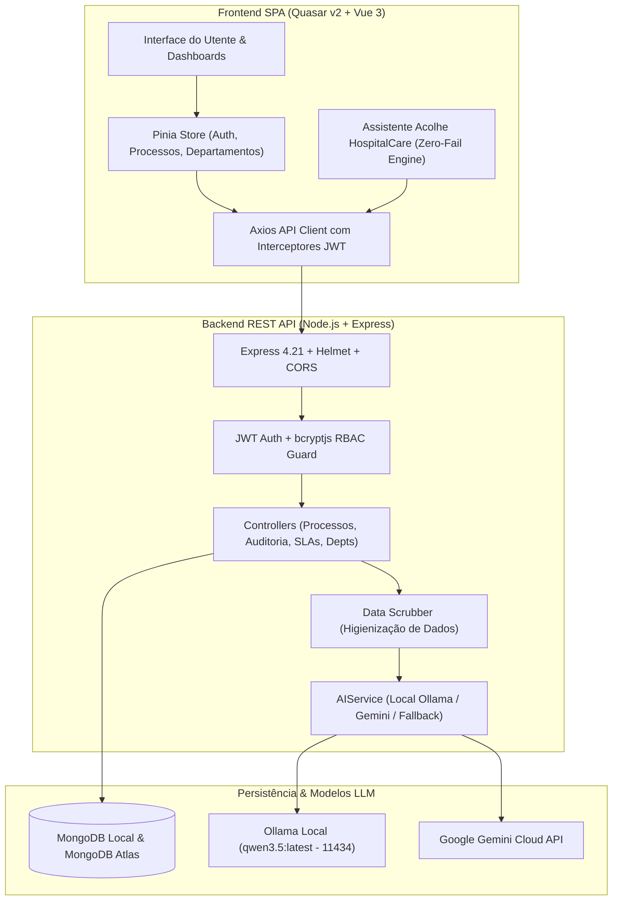
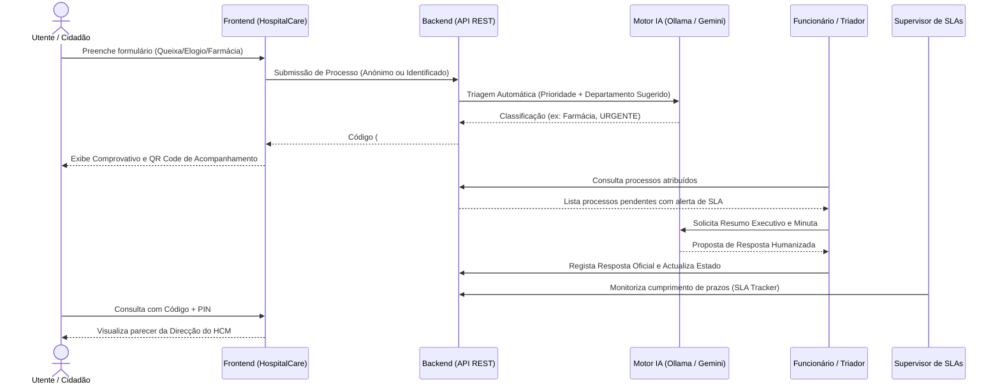

# Relatório Técnico Global do Sistema HospitalCare
**Hospital Central de Maputo (HCM) — Moçambique**

---

## 1. Identificação e Visão Geral do Sistema

O **HospitalCare** é uma plataforma institucional e hospitalar concebida especificamente para o contexto sanitário de Moçambique, implementada com o **Hospital Central de Maputo (HCM)** como unidade piloto. O objetivo primordial da plataforma é humanizar, digitalizar e monitorizar a tramitação de queixas, reclamações, sugestões e elogios apresentados por utentes e cidadãos, assegurando total transparência, conformidade com os Acordos de Nível de Serviço (SLA) e rigoroso sigilo médico-legal.

### Características Diferenciadoras:
- **Submissão 100% Anónima ou Identificada:** O cidadão não é obrigado a fornecer dados pessoais; recebe um **Código Único de Referência** (ex: `#HC-2026-XXXX`) e um **PIN de 4 dígitos** gerado criptograficamente para acompanhar o processo em qualquer dispositivo.
- **Motor de Inteligência Artificial Híbrido:** Integração com **Ollama local** (`qwen3.5:latest`), **Google Gemini 1.5 Flash** e um motor residente institucional para garantir zero falhas e processamento seguro no território nacional.
- **Auditoria Imutável e Rastreabilidade Total:** Todo o histórico de alterações de estado, mensagens internas e despachos da direção fica arquivado com carimbo temporal.

---

## 2. Arquitetura e Tecnologias do Sistema



---

## 3. Tecnologias do Frontend

| Tecnologia | Versão | Finalidade e Justificação |
| :--- | :--- | :--- |
| **Vue.js** | `^3.5.22` | Core framework reativo com Composition API e `<script setup lang="ts">` para alta manutenibilidade. |
| **Quasar Framework** | `^2.35.1` | Biblioteca corporativa de componentes de interface médica acessível (WCAG AAA), responsiva e rápida. |
| **Vite** | `^8.3.4` | Bundler e build tool ultrarrápido com Hot Module Replacement (HMR) e compilação otimizada. |
| **TypeScript** | `^6.0.0` | Tipagem estática rigorosa para garantir segurança em estruturas de dados de saúde. |
| **Pinia** | `^4.0.2` | Gestão de estado reativa e centralizada para autenticação, processos e permissões. |
| **Vue Router** | `^5.0.6` | Roteamento em modo Hash (`vueRouterMode: 'hash'`), ideal para publicação no GitHub Pages sem erros 404. |
| **Axios** | `^1.20.0` | Cliente HTTP com intercetores de cabeçalho `Authorization: Bearer <token>` e timeout adaptativo. |
| **Chart.js** | `^4.5.1` | Renderização de gráficos de desempenho (tempos de resposta, volume departamental e índice de satisfação). |
| **date-fns** | `^4.4.0` | Manipulação e formatação de datas alinhadas ao fuso horário de Moçambique (`Africa/Maputo`). |
| **Sass Embedded** | `^1.105.1` | Compilador SCSS nativo para o Design System com paleta institucional médica. |
| **Zod** | `^4.6.7` | Validação de esquemas de formulários no cliente com mensagens em Português. |

---

## 4. Tecnologias do Backend

| Tecnologia | Versão | Finalidade e Justificação |
| :--- | :--- | :--- |
| **Node.js** | `v22+` | Runtime assíncrono escalável executado em padrão ECMAScript Modules (ESM). |
| **Express.js** | `^4.21.2` | Framework web robusto para estruturação de rotas, middlewares e controlo de requisições. |
| **TypeScript** | `^5.9.3` | Compilação estrita (`tsc`) para garantir integridade e documentação viva das entidades. |
| **Mongoose** | `^9.11.2` | ODM (Object Data Modeling) com esquemas estritos, índices automáticos e validações. |
| **MongoDB** | `v7.0+` | Base de dados NoSQL orientada a documentos para armazenamento flexível de ocorrências médicas. |
| **JSON Web Token** | `^9.0.2` | Emissão de tokens de acesso stateless e refresh tokens para sessões seguras. |
| **bcryptjs** | `^2.4.3` | Algoritmo de hashing irreversível com salting de 10 rounds para proteção de palavras-passe. |
| **Helmet** | `^8.0.0` | Proteção contra vulnerabilidades web (XSS, clickjacking, MIME sniffing). |
| **Express Rate Limit** | `^7.5.0` | Prevenção de ataques de força bruta e negação de serviço (DoS) em rotas críticas. |
| **Multer** | `^2.5.0` | Gestão de uploads multipart de anexos com verificação de tipo de ficheiro e sanitização. |
| **Pino & Pino HTTP** | `^9.6.0` | Sistema de logging estruturado em JSON de alta performance para auditoria técnica. |
| **Swagger UI Express** | `^5.0.1` | Interface OpenAPI 3.0 interativa para documentação e teste de rotas em `/api/docs`. |
| **@google/generative-ai**| `^0.24.1` | Conector oficial para o modelo Google Gemini 1.5 Flash como motor em nuvem. |

---

## 5. Arquitetura de Inteligência Artificial Híbrida

O HospitalCare implementa um pipeline de IA de três camadas com foco em soberania de dados, privacidade do utente e tolerância a falhas de rede:

1. **Higienização Prévia de Dados (Data Scrubber):**
   - Antes de qualquer processamento por IA, o utilitário `data-scrubber.ts` remove números de BI, NUIT, contactos telefónicos e nomes próprios dos prompts, protegendo a privacidade médica.
2. **Camada 1 — IA Local (Ollama / `qwen3.5:latest`):**
   - Executa no próprio servidor ou rede hospitalar (`http://localhost:11434`), sem enviar dados para a internet.
   - Utiliza o modelo `qwen3.5:latest` (9.7B parâmetros, 6.6 GB) com timeout adaptativo de 12 segundos.
3. **Camada 2 — IA Cloud (Google Gemini 1.5 Flash):**
   - Utilizado em ambientes na nuvem (ex: Render) ou como contingência quando o motor local atinge o tempo limite.
4. **Camada 3 — Motor Residente HCM (Zero-Fail Engine):**
   - Integrado diretamente no componente `AiAssistantWidget.vue`. Caso a rede sofra latência ou o servidor entre em repouso, o assistente responde em **0 milissegundos** com a base de conhecimento institucional do HCM.

---

## 6. Utilizadores, Credenciais e Níveis de Acesso (RBAC)

O sistema possui quatro papéis bem definidos na base de dados:

### Matriz de Perfis e Credenciais Padrão:

| Nome do Utilizador | Email de Login | Palavra-passe | Perfil (Role) | Departamento Atribuído |
| :--- | :--- | :--- | :--- | :--- |
| **Eng. Rui Nhantumbo** | `rui.nhantumbo@hcm.gov.mz` | `123456` | `ADMIN` | Direcção / Informática |
| **Enf. Ana Bila** | `ana.bila@hcm.gov.mz` | `123456` | `SUPERVISOR` | Supervisão Clínica Geral |
| **Dr. Carlos Mondlane** | `carlos.mondlane@hcm.gov.mz` | `123456` | `STAFF` | Pediatria (`PED`) |
| **Dra. Fátima Noormahomed**| `fatima.noormahomed@hcm.gov.mz` | `123456` | `STAFF` | Farmácia Central (`FAR`) |
| **Maria Tembe** | `maria.tembe@exemplo.co.mz` | `123456` | `PATIENT` | Utente Geral do HCM |
| **Cidadão Anónimo** | *Sem login (Acesso livre)* | *PIN de 4 dígitos* | *PÚBLICO* | Não aplicável |

### Matriz de Permissões:

| Módulo / Funcionalidade | ADMIN | SUPERVISOR | STAFF | PATIENT | PÚBLICO (ANÓNIMO) |
| :--- | :---: | :---: | :---: | :---: | :---: |
| Submeter Reclamação / Queixa / Elogio | ✅ | ✅ | ✅ | ✅ | ✅ |
| Consultar com Código e PIN | ✅ | ✅ | ✅ | ✅ | ✅ |
| Chat com Assistente "Acolhe HospitalCare" | ✅ | ✅ | ✅ | ✅ | ✅ |
| Painel Pessoal de Utente | ❌ | ❌ | ❌ | ✅ | ❌ |
| Responder e Tramitar Processos | ✅ | ✅ | ✅ | ❌ | ❌ |
| Copiloto IA (Resumo e Minuta de Resposta)| ✅ | ✅ | ✅ | ❌ | ❌ |
| Reatribuição Departamental e Gestão de SLA | ✅ | ✅ | ❌ | ❌ | ❌ |
| Dashboard Executivo e Relatórios | ✅ | ✅ | ❌ | ❌ | ❌ |
| Gestão de Utilizadores, Departamentos e FAQs | ✅ | ❌ | ❌ | ❌ | ❌ |
| Visualização de Logs de Auditoria | ✅ | ❌ | ❌ | ❌ | ❌ |

---

## 7. Como Funciona o Sistema (Módulos Operacionais)



### Detalhe dos Módulos Principais:
1. **Módulo do Utente (Portal do Cidadão):** Submissão simplificada em 3 passos com suporte a upload de fotos/receitas e escolha de sigilo total.
2. **Módulo de Consulta Confidencial:** Acesso direto sem registo prévio, garantindo que cidadãos sem email ou smartphone avançado possam consultar o estado da manifestação em quiosques ou balcões.
3. **Módulo Acolhe HospitalCare (Assistente Virtual):** Guia em linguagem natural disponível 24h/7d no canto inferior da página.
4. **Módulo Staff / Triagem:** Espaço onde o médico ou funcionário administrativo analisa a ocorrência com auxílio de IA.
5. **Módulo de Supervisão e Gestão de SLA:** Monitoriza o relógio de contagem decrescente para cada categoria de processo.
6. **Módulo de Auditoria e Conformidade:** Registo à prova de adulteração de todas as operações realizadas na base de dados.

---

## 8. Inventário Geral de Bibliotecas Externas

### No Backend (`backend/package.json`):
- `express` (`4.21.2`): Servidor HTTP e encaminhamento de pedidos REST.
- `mongoose` (`9.11.2`): Conexão e modelagem de entidades do MongoDB.
- `bcryptjs` (`2.4.3`): Algoritmo de encriptação unidirecional para senhas.
- `jsonwebtoken` (`9.0.2`): Criação e validação de tokens JWT.
- `cors` (`2.8.5`): Controlo de acesso entre origens para web e telemóvel.
- `helmet` (`8.0.0`): Configuração de cabeçalhos de segurança HTTP.
- `express-rate-limit` (`7.5.0`): Mitigação de ataques de força bruta.
- `multer` (`2.5.0`): Leitura e armazenamento de ficheiros em `uploads/`.
- `pino` e `pino-http` (`9.6.0`): Logger assíncrono de alto rendimento.
- `pino-pretty` (`13.0.0`): Formatação legível dos logs em ambiente de desenvolvimento.
- `zod` (`3.24.1`): Validação de tipos em tempo de execução.
- `dotenv` (`16.4.7`): Carregamento de variáveis de ambiente a partir de `.env`.
- `swagger-ui-express` (`5.0.1`): Renderização visual da documentação OpenAPI.
- `@google/generative-ai` (`0.24.1`): SDK oficial da Google para integração com Gemini.
- `tsx` (`4.23.15`): Executor e watcher de TypeScript em desenvolvimento.
- `vitest` e `supertest`: Execução de testes unitários e de integração de rotas.

### No Frontend (`frontend/package.json`):
- `vue` (`3.5.22`): Núcleo da interface de utilizador.
- `quasar` (`2.35.1`): Biblioteca de componentes e utilitários de interface.
- `@quasar/app-vite` (`3.10.2`): Builder de aplicações Quasar baseado em Vite.
- `pinia` (`4.0.2`): Armazém de dados reativo compartilhado.
- `vue-router` (`5.0.6`): Motor de navegação por URLs com histórico de rotas.
- `axios` (`1.20.0`): Comunicação HTTP com o backend.
- `chart.js` (`4.5.1`): Gráficos de barras, linhas e circulares nos dashboards.
- `date-fns` (`4.4.0`): Funções puras de formatação e cálculo de intervalos de tempo.
- `highlight.js` (`11.12.0`): Realce de sintaxe em blocos de código e dados estruturados.
- `sass-embedded` (`1.105.1`): Compilação ultrarrápida de folhas de estilo SCSS.
- `zod` (`4.6.7`): Validação de regras de negócio em formulários.

---

## 9. Guia Passo a Passo para Correr o Projeto no VS Code

### Pré-requisitos
1. **Node.js** versão 20, 22 ou superior instalada ([nodejs.org](https://nodejs.org/)).
2. **MongoDB Community Server** instalado e a correr no serviço local (`mongodb://127.0.0.1:27017`), ou uma ligação ao **MongoDB Atlas**.
3. **Ollama** instalado localmente com o modelo `qwen3.5:latest` (`ollama run qwen3.5:latest`) para a IA local.

---

### Passo 1: Abrir o Projeto no VS Code
Abra o Visual Studio Code e selecione a pasta raiz do projeto:
```
c:\Users\Tino Eduardo\Desktop\PROJECTO_DA
```

---

### Passo 2: Configurar as Variáveis de Ambiente

#### Backend (`backend/.env`):
Certifique-se de que o ficheiro `backend/.env` contém a seguinte configuração:
```env
PORT=5000
NODE_ENV=development
DATABASE_URL=mongodb://127.0.0.1:27017/hospitalcare
JWT_SECRET=hospitalcare_super_secret_jwt_key_2026_mz
JWT_REFRESH_SECRET=hospitalcare_refresh_secret_key_2026_mz
JWT_EXPIRES_IN=1d
JWT_REFRESH_EXPIRES_IN=7d
CORS_ORIGIN=*

# Motor de Inteligência Artificial Híbrido
AI_PROVIDER=local
LOCAL_AI_URL=http://localhost:11434
LOCAL_AI_MODEL=qwen3.5:latest
GEMINI_MODEL=gemini-1.5-flash
# GEMINI_API_KEY=sua_chave_opcional_aqui
```

---

### Passo 3: Povoar a Base de Dados (Seed Inicial)
Se for a primeira execução ou desejar restaurar os dados de demonstração:
Abra um terminal no VS Code (`Ctrl + ~`) e execute:
```powershell
cd backend
npm run seed
```
> O comando criará os departamentos (Pediatria, Urgência, Farmácia, etc.), as categorias de queixa e os utilizadores demo com palavra-passe `123456`.

---

### Passo 4: Executar o Projeto

Recomendamos utilizar **dois terminais divididos** no VS Code:

#### Terminal 1 — Servidor Backend (Porta 5000):
```powershell
cd backend
npm run dev
```
*Saída esperada:*
```
[INFO] ✅ Ligação à base de dados MongoDB estabelecida: 127.0.0.1:27017/hospitalcare
[INFO] 🚀 Servidor HospitalCare ativo na porta 5000
[INFO] 📚 Documentação Swagger disponível em: http://localhost:5000/api/docs
```

#### Terminal 2 — Servidor Frontend Quasar (Porta 9090):
```powershell
cd frontend
npm run dev
```
*Saída esperada:*
```
» App URL................ http://localhost:9090/
» Dev mode............... SPA
» Pkg quasar............. v2.35.1
```

---

### Passo 5: Testar no Navegador

1. **Aceder à Aplicação:** Abra [http://localhost:9090/#/](http://localhost:9090/#/) no seu navegador.
2. **Testar como Cidadão:**
   - Clique em **"Registar Reclamação"** e faça uma submissão de teste.
   - Guarde o Código `#HC-...` e o PIN fornecidos.
   - Aceda a **"Consultar Processo"** e valide a consulta imediata.
   - Clique no ícone azul flutuante no canto inferior direito para conversar com o **Acolhe HospitalCare**.
3. **Testar com Credenciais:**
   - Clique em **"Entrar"** no menu superior.
   - Entre com `admin@hospitalcare.mz` / `Admin@123456` ou `rui.nhantumbo@hcm.gov.mz` / `123456` para aceder ao Painel Administrativo.
   - Entre com `carlos.mondlane@hcm.gov.mz` / `123456` para ver os processos e o Copiloto de IA.
4. **Documentação de Rotas:** Aceda a [http://localhost:5000/api/docs](http://localhost:5000/api/docs) para inspecionar todos os endpoints REST disponíveis.
