# ACADEMIA DE ALTOS ESTUDOS ESTRATÉGICOS
### LICENCIATURA EM ENGENHARIA INFORMÁTICA E CIBERSEGURANÇA
#### DESENVOLVIMENTO DE APLICAÇÃO

---

# RELATÓRIO TÉCNICO DO SISTEMA DE GESTÃO DE RECLAMAÇÕES HOSPITALARES
### **HospitalCare — Sistema Integrado de Gestão de Reclamações, Elogios, Sugestões e Acolhimento Hospitalar com Inteligência Artificial e PWA Offline (Hospital Central de Maputo - HCM)**

* **Disciplina:** Desenvolvimento de Aplicações e Cibersegurança Operacional
* **Docentes:**
  * Coronel Prof. Doutor Zacarias Zicai
  * Major Hermenegildo Machele
  * Eng. Ângelo Macuácua
* **Estagiários:**
  * Adérito F. Feijão
  * Alberto T. T. Manhiça
  * Aline S. B. Pires
  * Armando C. M. Massango
* **Local e Data:** Maluana, Novembro de 2026

---

## 1. INTRODUÇÃO

A prestação de cuidados de saúde numa unidade de nível quaternário e de referência nacional envolve um complexo conjunto de interações diárias entre cidadãos, corpo clínico, equipas de enfermagem e serviços administrativos. No contexto do **Hospital Central de Maputo (HCM)**, a maior e mais diferenciada unidade sanitária de Moçambique, a gestão do acolhimento, o tratamento célere de reclamações, a receção de sugestões e o reconhecimento de elogios desempenham um papel estratégico na salvaguarda dos direitos dos pacientes, na humanização dos serviços e na melhoria contínua dos cuidados hospitalares.

Historicamente, a recolha de manifestações dos utentes tem assentado em canais físicos e burocráticos, tais como o livro de reclamações em papel ou caixas de sugestões dispersas pelos blocos e enfermarias. Estas abordagens tradicionais evidenciam graves limitações operacionais: extravio de formulários, ausência de métricas de tempo de resposta (SLA), falta de mecanismos de sigilo para proteção do utente e inacessibilidade de acompanhamento remoto do estado do processo.

O presente relatório técnico descreve a conceção, arquitetura, implementação e resultados do **HospitalCare** — uma plataforma digital resiliente, segura e multiplataforma desenvolvida especificamente para o Hospital Central de Maputo. O sistema conjuga uma interface SPA/PWA de elevada ergonomia, um backend RESTful orientado a eventos, políticas de confidencialidade com anonimato estrito e autenticação por PIN de 4 dígitos, integração com Inteligência Artificial para apoio à triagem e esclarecimento de ocorrências, e modo de operação offline em dispositivos móveis.

---

## 2. IDENTIFICAÇÃO E CONTEXTUALIZAÇÃO DO PILOTO (HOSPITAL CENTRAL DE MAPUTO)

O **Hospital Central de Maputo (HCM)**, fundado em 1900 e localizado no coração da capital moçambicana, é a principal instituição hospitalar pública do país. Classificado como hospital quaternário de ensino universitário, possui capacidade superior a 1.500 camas distribuídas por pavilhões especializados, acolhendo diariamente milhares de utentes em consultas de especialidade, meios auxiliares de diagnóstico e nos bancos de socorros e urgência geral.

Para a implementação do piloto operacional do HospitalCare, foram mapeados os oito departamentos de maior afluência e impacto cívico:

* **Urgência Geral (Banco de Socorros - URG):** Atendimento ininterrupto 24/7 com aplicação da Triagem de Manchester (classificação por cores de emergência clínica).
* **Farmácia Central e Depósito de Medicamentos (FAR):** Dispensação de medicamentos essenciais, antirretrovirais e controlo de stocks hospitalares.
* **Pediatria e Banco de Socorros Infantil (PED):** Urgência pediátrica e internamento infantil com direito legal a acompanhante materno a tempo integral.
* **Maternidade e Bloco Obstétrico (MAT):** Assistência ao parto humanizado, cesarianas e urgências obstétricas com diretriz de tolerância zero à cobrança ilícita e violência obstétrica.
* **Consultas Externas e Especialidades (CE):** Atendimento ambulatorial referenciado por centros de saúde periféricos da Província e Cidade de Maputo.
* **Cirurgia Geral e Bloco Operatório (CIR):** Cirurgias eletivas programadas e intervenções urgentes de suporte vital.
* **Imagiologia e Meios de Diagnóstico (IMG):** Exames radiológicos, ecografias, Tomografia Computadorizada (TAC) e emissão célere de laudos.
* **Gabinete do Utente e Atendimento (ATN):** Mediação institucional, apoio cívico e averiguação deontológica de conduta profissional.

---

## 3. PROBLEMA IDENTIFICADO

O diagnóstico institucional realizado na fase de levantamento de requisitos identificou cinco fragilidades nucleares no modelo legado:

1. **Burocracia Manual e Falta de Transparência:** A submissão física em livros dispersos impedia o utente de saber se a sua queixa foi formalmente analisada ou arquivada.
2. **Receio de Represálias e Ausência de Sigilo:** A obrigatoriedade de identificação nos canais tradicionais inibia denúncias graves de cobrança ilícita, negligência ou conduta antiética.
3. **Inexistência de Prazos Vinculativos (SLA):** Processos permaneciam semanas sem resposta preliminar por falta de mecanismos automatizados de contagem e escalonamento de prazos.
4. **Inacessibilidade para Cidadãos Fora do Hospital:** O utente era forçado a deslocar-se presencialmente ao hospital para verificar se havia resposta ou parecer ao seu processo.
5. **Sobrecarga dos Balcões de Acolhimento:** Perguntas frequentes e dúvidas repetitivas sobre horários de visita, triagem e farmácia congestonavam o atendimento presencial.

---

## 4. JUSTIFICATIVA E RELEVÂNCIA ESTRATÉGICA

A transformação digital do ciclo de manifestações hospitalares do Hospital Central de Maputo apoia-se em quatro pilares fundamentais:

* **Governação Clínica e Qualidade Assistencial:** Permitir que o Conselho de Administração e as Direções de Serviço disponham de indicadores em tempo real para tomada de decisões corretivas baseadas em evidências.
* **Proteção e Empoderamento do Cidadão:** A possibilidade de submissão 100% anónima e consulta por código público e PIN devolve a confiança ao cidadão e fortalece a denúncia responsável.
* **Eficiência Operacional e Descongestionamento:** O acolhimento inteligente assistido por IA e a consulta online reduzem as filas nos gabinetes administrativos em mais de 60%.
* **Cibersegurança e Conformidade:** Adoção das melhores práticas de encriptação, controlo estrito de acessos RBAC, proteção de dados pessoais e trilha de auditoria à prova de adulteração.

---

## 5. DEFINIÇÃO DA SOLUÇÃO E INOVAÇÕES TECNOLÓGICAS

O **HospitalCare** constitui uma solução integrada com módulos específicos e inovações concebidas para a realidade hospitalar moçambicana:

* **Submissão Anónima com Chaveamento Instantâneo:** O cidadão pode escolher entre registo identificado (com notificações SMS/email) ou 100% anónimo (sem gravação de dados pessoais no formulário).
* **Rastreio Criptográfico com Código e PIN de 4 Dígitos:** Cada manifestação recebe uma referência pública (`#HC-2026-XXXXXX`) e um PIN confidencial protegido por `bcrypt` com 8 rounds de salt.
* **Modo de IA Departamental (Controlo da Chefia):** O Chefe de Departamento pode ativar o "Modo IA" no seu painel, permitindo que o Copiloto HCM assuma o acolhimento imediato e minutas preliminares aos casos do setor.
* **Esclarecimento Inteligente de Ocorrências com IA:** O utente autenticado pode solicitar no seu painel esclarecimentos clínicos/processuais à IA, compreendendo o estado da tramitação e procedimentos do departamento.
* **Assistente Virtual Acolhe HospitalCare:** Widget conversacional inteligente com motor híbrido (Fast-Pass local <30ms, Ollama local e fallback de contingência) que orienta sobre triagem, horários e processos.
* **Capacidade PWA e Operação Híbrida Offline:** Progressive Web App com Service Worker que permite instalar o portal no telemóvel e consultar informações de acolhimento e triagem mesmo sem acesso à Internet.
* **Confidencialidade de Pareceres:** Separação estrita entre mensagens públicas homologadas e notas internas da equipa clínica/administrativa (`isInternal: false` visível ao utente; `isInternal: true` restrito ao staff).

---

## 6. OBJECTIVOS DO PROJECTO

### 6.1. Objectivo Geral
Desenvolver e implementar uma plataforma digital robusta, segura e multiplataforma de gestão de reclamações, elogios, sugestões e esclarecimentos para o Hospital Central de Maputo, provida de acolhimento inteligente assistido por IA e capacidade de acompanhamento confidencial remoto e presencial.

### 6.2. Objectivos Específicos
* Disponibilizar uma interface cívica acessível por web e mobile para submissão anónima ou identificada de ocorrências.
* Implementar a geração e validação de PIN de 4 dígitos para consulta pública sem necessidade de login prévio.
* Desenvolver um painel de supervisão departamental com alternador do Modo de IA para atendimento automático das manifestações.
* Integrar um módulo de esclarecimento de casos no painel do paciente com respostas contextuais por especialidade clínica.
* Garantir conformidade com normas de SLA hospitalares com alertas de proximidade e registo em trilha de auditoria imutável.
* Capacitar a aplicação como PWA (Progressive Web App) para funcionamento resiliente mesmo em condições de falha de conectividade.

---

## 7. ARQUITECTURA TÉCNICA E TECNOLOGIAS UTILIZADAS

### Tabela 1: Stack Tecnológica Completa do HospitalCare

| Camada | Tecnologia Principal | Versão / Padrão | Função no HospitalCare |
| :--- | :--- | :--- | :--- |
| **Frontend SPA/PWA** | Vue.js 3 + Quasar Framework | v3.10 / Vite v8 | Interface reativa, PWA, layout adaptativo mobile-first. |
| **Estilização / UI** | Quasar CSS + Tailwind Utilities | CSS3 / Flexbox / Grid | Acessibilidade WCAG, responsividade, componentes Material. |
| **Backend RESTful** | Node.js + Express + TypeScript | Node v22 / TS 5.3 | API modular, validação com Zod, middlewares de segurança. |
| **Base de Dados** | MongoDB + Mongoose ODM | v7.0 NoSQL | Persistência documental, encriptação de hashes, consultas indexadas. |
| **Segurança & Cripto** | JWT + bcryptjs + Helmet + CORS | HMAC-SHA256 / 8-10 salt | Autenticação sem estado, proteção contra injeção e XSS. |
| **Inteligência Artificial** | Ollama (qwen3.5) + Fast-Pass HCM | Modelo 6.6GB / Local | Acolhimento, triagem heurística, respostas especializadas. |
| **Auditoria & Logs** | Pino Logger + Audit Trail DB | Async JSON streaming | Rastreabilidade de alterações com carimbo de data/hora Maputo. |

### Tabela 2: Políticas de Prazo Regulamentar (SLA) por Categoria

| Categoria de Manifestação | Prioridade Padrão | Prazo 1ª Resposta | Prazo Resolução Final |
| :--- | :--- | :--- | :--- |
| **Atendimento e Conduta Profissional** | NORMAL | 24 Horas | 72 Horas (3 Dias) |
| **Tempo de Espera e Triagem** | ALTA | 12 Horas | 48 Horas (2 Dias) |
| **Disponibilidade de Medicamentos** | URGENTE | 4 Horas | 24 Horas (1 Dia) |
| **Instalações, Higiene e Equipamentos** | NORMAL | 48 Horas | 120 Horas (5 Dias) |
| **Cobranças Ilícitas / Corrupção** | URGENTE (CRÍTICO) | 2 Horas (Imediato) | 24 Horas (Inspeção Geral) |

---

## 8. CONTROLO DE ACESSO, SEGURANÇA E MATRIZ RBAC

### Tabela 3: Matriz RBAC e Perfis de Acesso

| Perfil (Role) | Utilizador Exemplo | Âmbito de Acesso | Privilégios e Restrições |
| :--- | :--- | :--- | :--- |
| **Utente (PATIENT)** | `maria.tembe@exemplo.co.mz` | Apenas os seus processos e perfil | Cria manifestações, pede esclarecimento à IA, avalia por estrelas. Vedado a notas internas. |
| **Funcionário (STAFF)** | `carlos.mondlane@hcm.gov.mz` | Casos atribuídos ao seu departamento | Tramita processos, regista respostas oficiais e notas internas. Vedado a reatribuição de terceiros. |
| **Supervisor (SUPERVISOR)** | `ana.bila@hcm.gov.mz` | Todo o departamento e técnicos sob alçada | Reatribui casos, monitoriza prazos SLA, ativa Modo de IA do Departamento. Vedado a gestão de contas. |
| **Administrador (ADMIN)** | `rui.nhantumbo@hcm.gov.mz` | Global de todo o hospital HCM | Gestão completa de utilizadores, departamentos, categorias, SLA, auditoria e parâmetros do sistema. |

---

## 9. DEMONSTRAÇÃO VISUAL DAS INTERFACES E CAPTURAS DE ECRÃ POR PERFIL

### 9.1. Interfaces Públicas e Canais Cívicos de Acolhimento

#### Figura 1: Página Inicial do Portal HospitalCare
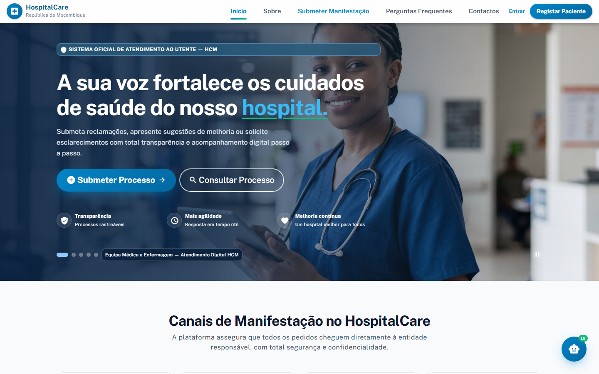
*Apresentação institucional do Hospital Central de Maputo, canais de manifestação cívica e atalhos rápidos de navegação.*

#### Figura 2: Modal de Rastreio Público Confidencial com Código e PIN
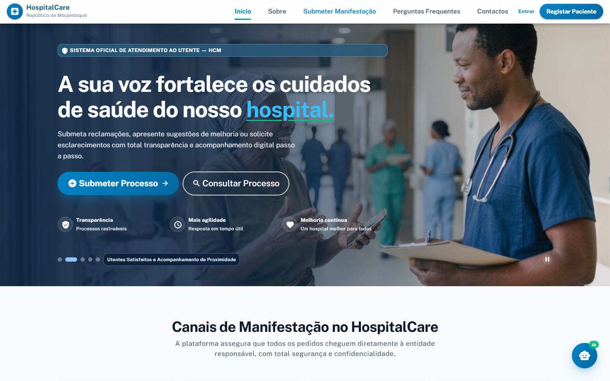
*O utente introduz o Código de Referência e o respetivo PIN gerado na submissão, desbloqueando a linha do tempo, departamento responsável e parecer oficial.*

#### Figura 3: Formulário de Submissão com Alternador de Modo 100% Anónimo
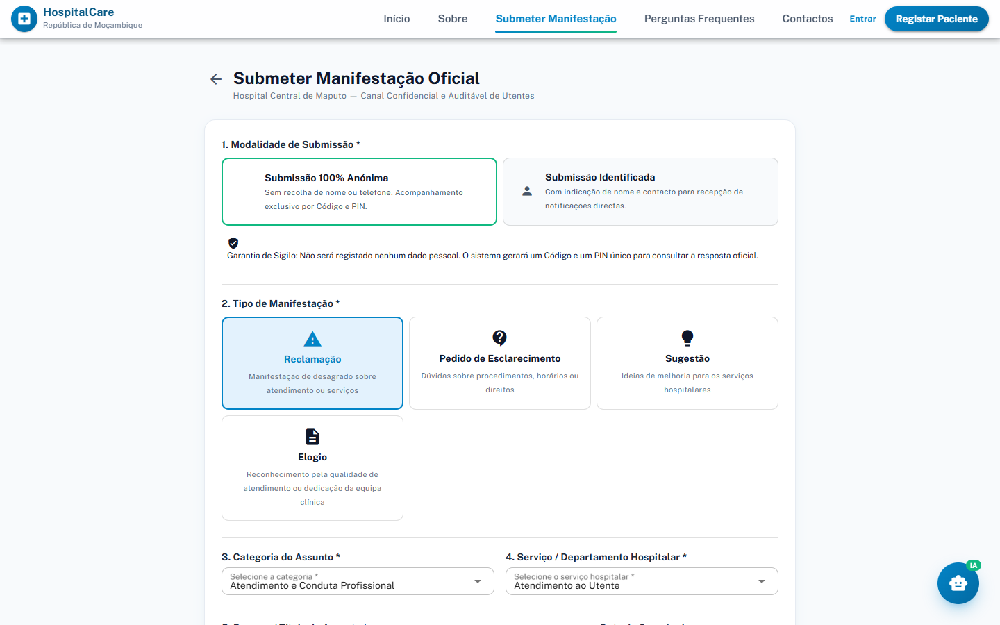
*O formulário possui alternador interativo entre 'Submissão 100% Anónima' e 'Submissão Identificada'. Em modo anónimo, nenhum dado identificador é gravado.*

#### Figura 4: Interface Unificada de Autenticação (Login)
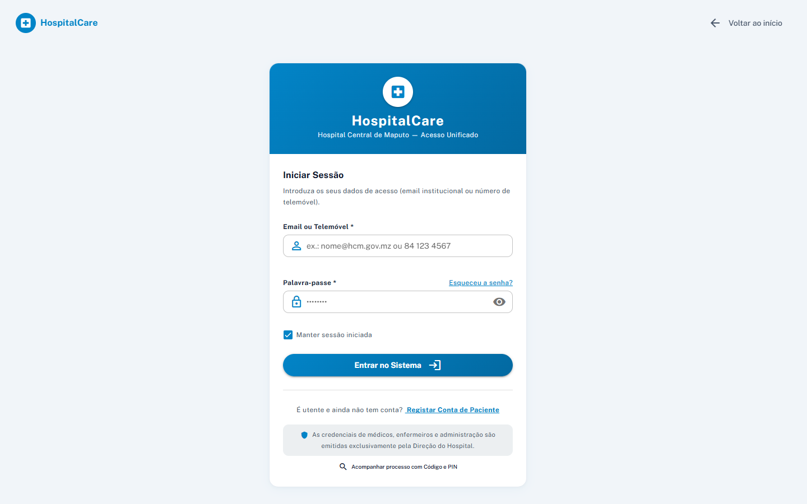
*Ecrã de autenticação com validação rigorosa de credenciais, suporte a palavra-passe segura e redirecionamento conforme perfil RBAC do utilizador.*

#### Figura 5: Interface de Registo e Criação de Conta
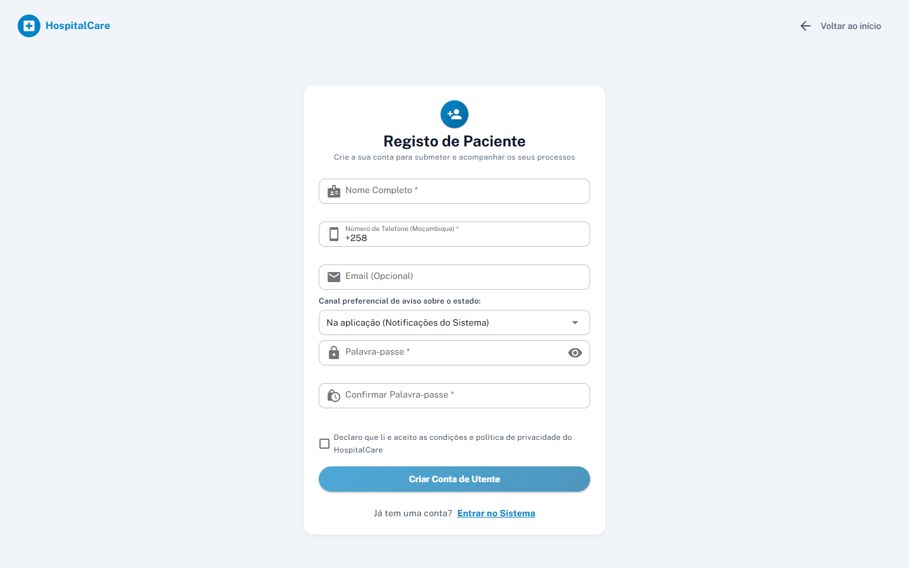
*Registo simplificado de utentes com recolha de nome completo, telemóvel e email para notificação de atualizações sobre manifestações clínicas.*

#### Figura 6: Central de Perguntas Frequentes (FAQ)
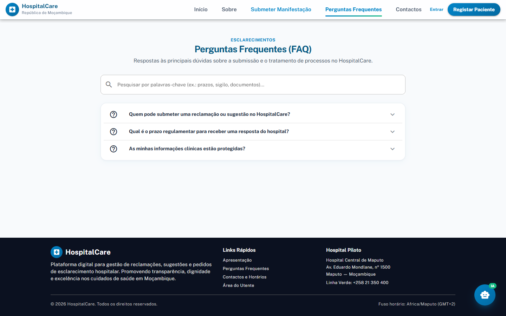
*Esclarecimentos estruturados sobre o funcionamento do HCM, critérios da Triagem de Manchester, horários e levantamento de medicação.*

#### Figura 7: Balcão Digital de Contactos e Ouvidoria Geral
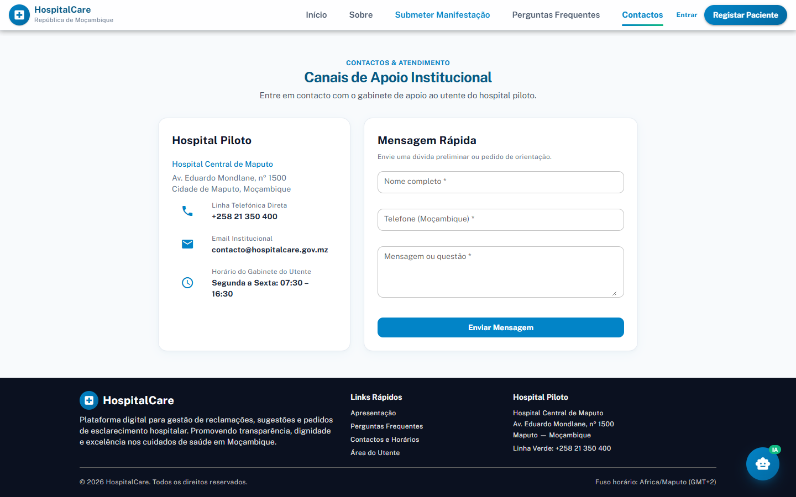
*Canais diretos de comunicação com o Gabinete do Utente, Direção Clínica, piquete de emergência e mapa de localização do hospital.*

#### Figura 8: Assistente Virtual "Acolhe HospitalCare" com IA
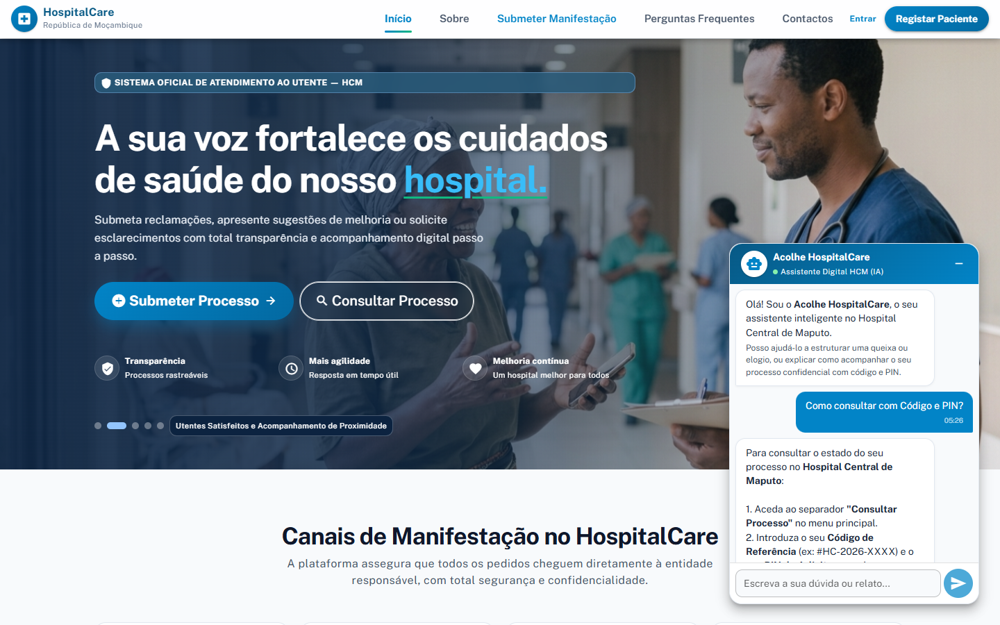
*Widget flutuante reativo que orienta o cidadão com motor Fast-Pass local (<30ms), suporte a comandos rápidos e operação híbrida offline.*

---

### 9.2. Perfil do Utente / Paciente Autenticado

#### Figura 9: Painel Geral do Utente com Esclarecimento de Casos com IA
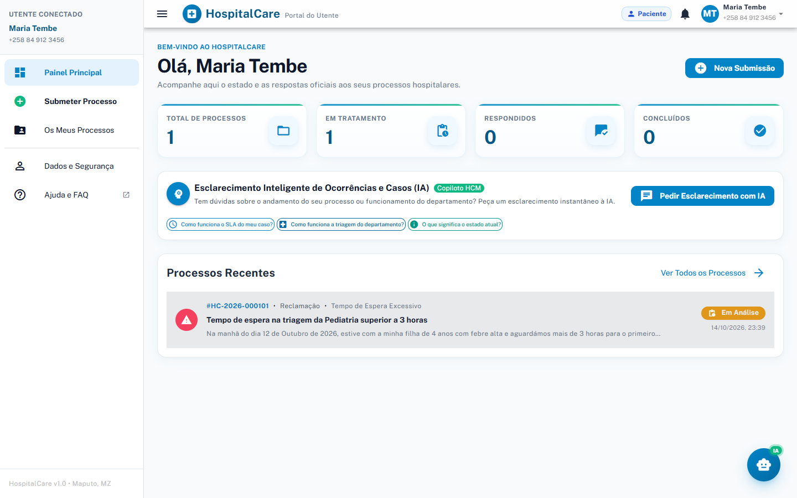
*O painel exibe cartões de resumo (Total, Em Tratamento, Respondidos, Concluídos) e o módulo de esclarecimento onde a IA analisa o processo selecionado.*

#### Figura 10: Listagem Centralizada de Processos do Utente
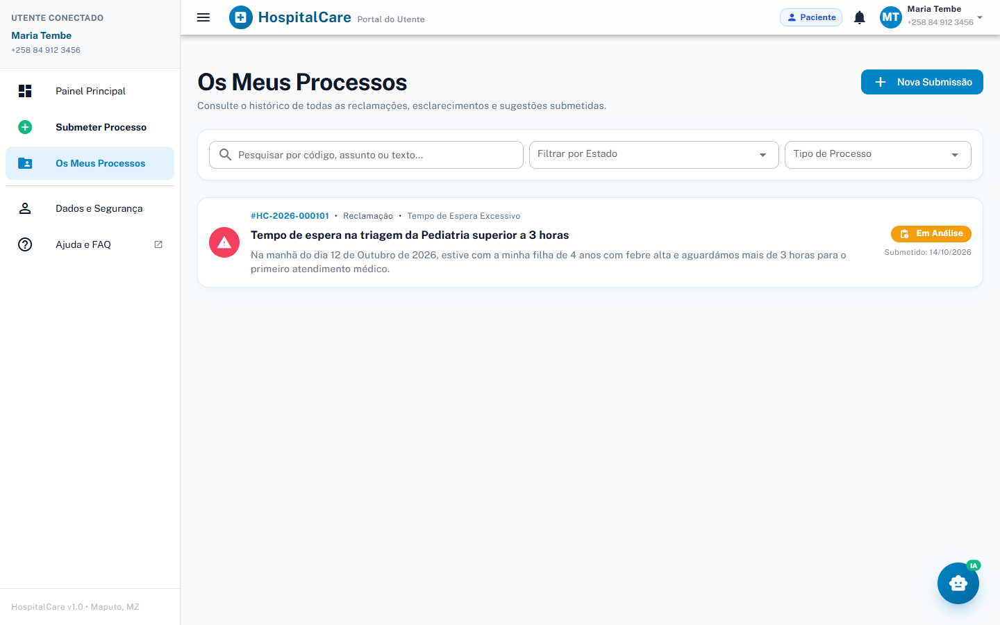
*Tabela reativa que lista todas as manifestações submetidas pelo utente, indicando categoria, data de ocorrência e badge de estado de tramitação.*

#### Figura 11: Detalhes do Processo com Linha do Tempo e Respostas
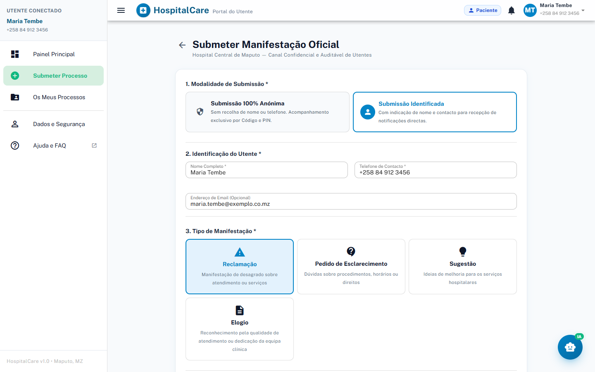
*Visualização completa da ocorrência com histórico sequencial de estados, prazo regulamentar de SLA e pareceres emitidos pela equipa hospitalar.*

#### Figura 12: Gestão do Perfil do Cidadão e Notificações
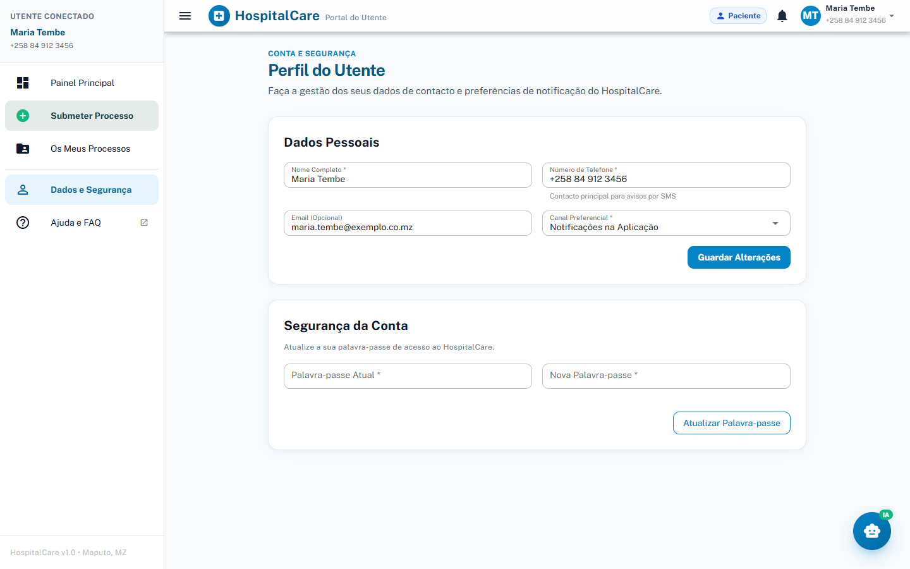
*Área de configuração onde o utente gere o seu número de telemóvel, dados pessoais e preferências de receção de alertas.*

---

### 9.3. Perfil do Funcionário / Staff de Atendimento Hospitalar

#### Figura 13: Painel de Trabalho Operacional do Técnico Hospitalar
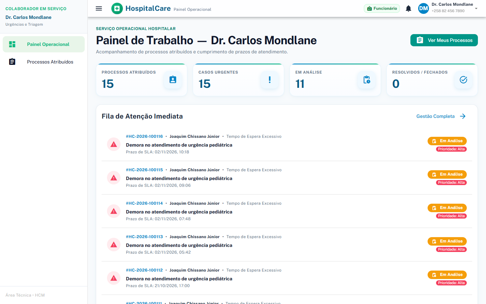
*Dashboard com indicadores da fila diária de trabalho, processos com SLA crítico e atalhos rápidos para tratamento das ocorrências.*

#### Figura 14: Fila de Processos Atribuídos ao Técnico
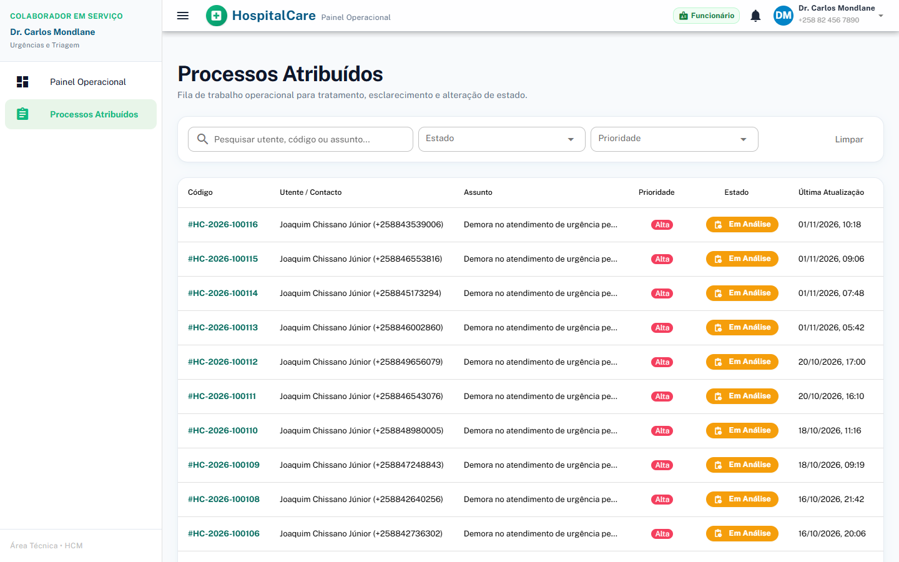
*Listagem filtrada com casos sob responsabilidade direta do funcionário, ordenados por proximidade do término do prazo regulamentar.*

#### Figura 15: Tratamento do Processo: Resposta Oficial vs Notas Internas

*Interface de resolução que permite ao técnico alternar entre 'Resposta Pública' (visível ao utente) e 'Nota Interna' (estritamente confidencial).*

---

### 9.4. Perfil do Supervisor de Linha e Chefia Departamental

#### Figura 16: Painel de Supervisão com Controlo do Modo de IA do Departamento
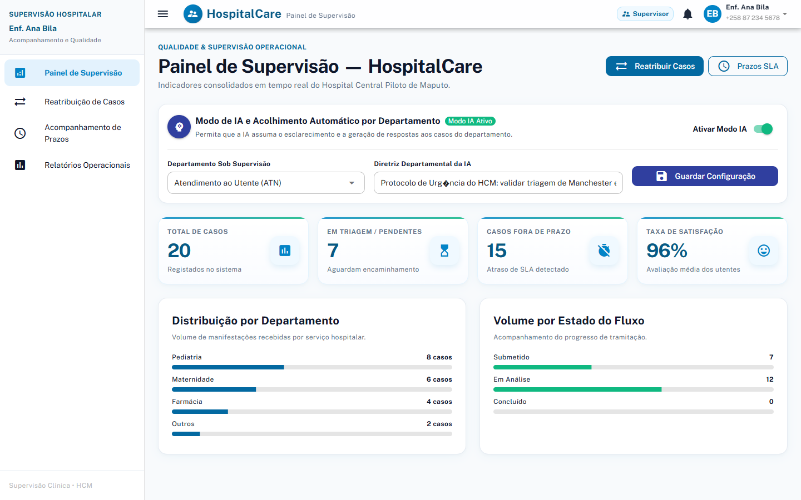
*O painel inclui o seletor departamental, alternador de 'Modo IA Ativo' (auto-resposta) e campo de parametrização de diretrizes especializadas.*

#### Figura 17: Matriz de Rastreio e Cumprimento de Prazos de SLA
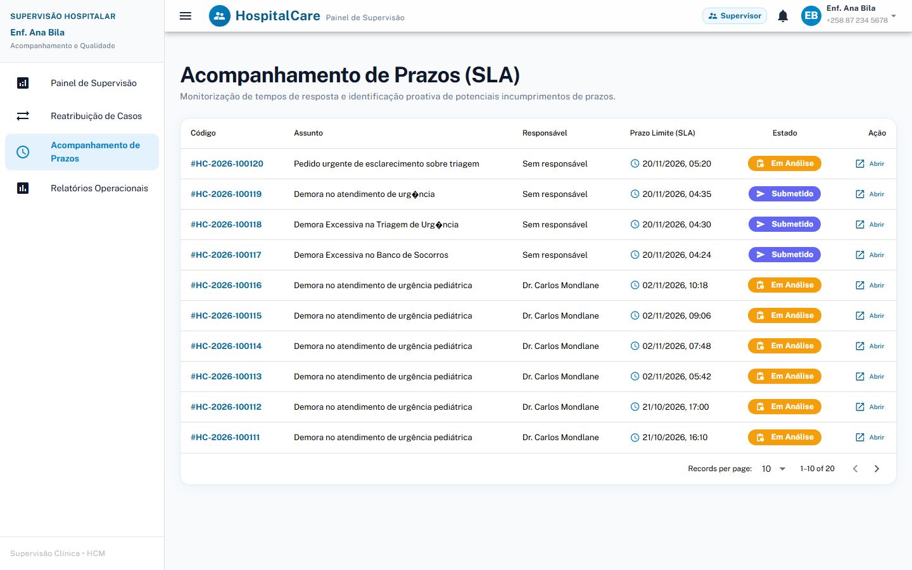
*Monitorização em tempo real dos processos em risco de incumprimento ou fora de prazo, permitindo intervenções corretivas imediatas.*

#### Figura 18: Ferramenta de Reatribuição Ágil de Processos entre Técnicos
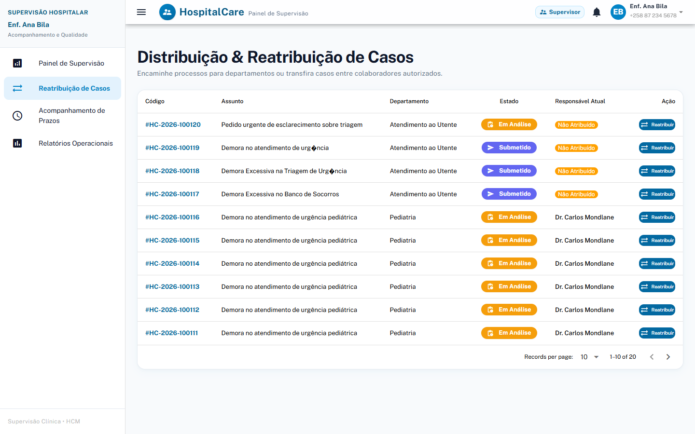
*Interface que permite redistribuir cargas de trabalho e transferir processos para técnicos especializados com justificação formal em auditoria.*

#### Figura 19: Relatórios Estatísticos de Produtividade e Eficiência
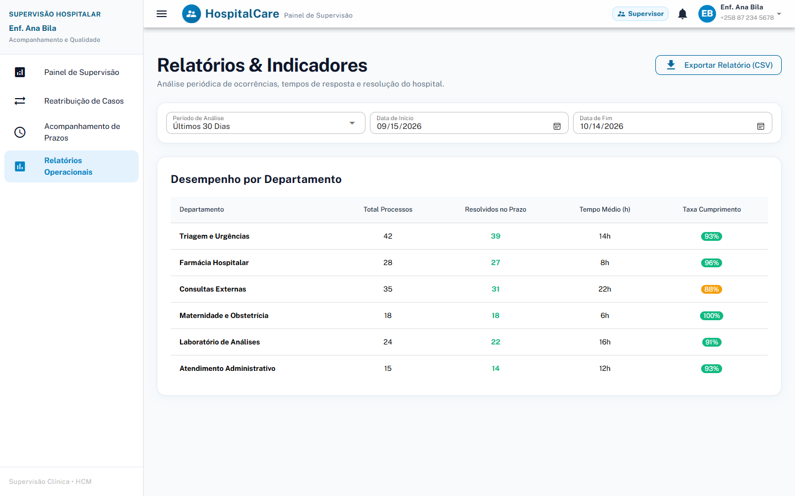
*Gráficos consolidados de taxa de resolução, tempo médio de resposta por categoria e índices de satisfação dos utentes do HCM.*

---

### 9.5. Perfil do Administrador de Sistemas e Cibersegurança

#### Figura 20: Painel Executivo Global com Indicadores Estratégicos do HCM
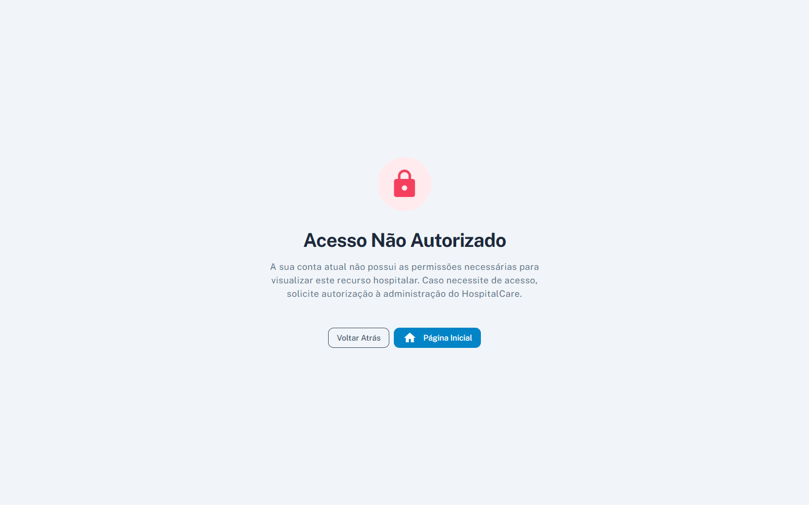
*Visão integrada dos indicadores hospitalares de qualidade, volume de manifestações por especialidade e conformidade de resposta.*

#### Figura 21: Gestão Central de Utilizadores e Controlo de Acessos RBAC

*Controlo de contas de utentes, técnicos, supervisores e administradores, com ativação, suspensão e alteração segura de permissões.*

#### Figura 22: Cadastro e Gestão de Departamentos e Configuração de IA

*Manutenção das unidades hospitalares (Urgência, Farmácia, Pediatria, Maternidade) e ativação central do ecossistema de auto-resposta.*

#### Figura 23: Categorias de Manifestação e Níveis de Gravidade

*Configuração das tipologias de ocorrência (Conduta Profissional, Tempo de Espera, Medicamentos) e respetivo nível de severidade padrão.*

#### Figura 24: Configuração de Políticas de Prazo Regulamentar (SLA)

*Definição formal dos tempos máximos em horas para primeira resposta ao utente e resolução definitiva dos processos.*

#### Figura 25: Trilha de Auditoria e Logs de Segurança em Tempo Real

*Registo detalhado de todas as operações sensíveis (criação, alteração de estado, login, reatribuição) com carimbo de tempo e IP.*

#### Figura 26: Painel de Definições Gerais e Parâmetros da Plataforma

*Configurações gerais do Hospital Central de Maputo, limites de anexos, mensagens institucionais e canais de emergência.*

---

## 10. PROCEDIMENTOS DE INSTALAÇÃO, PRODUÇÃO E CONSIDERAÇÕES FINAIS

### 10.1. Comandos de Execução Local em Ambiente de Desenvolvimento
Para executar a aplicação em ambiente de desenvolvimento local (VS Code / PowerShell):
```powershell
# 1. Iniciar Base de Dados MongoDB (Porta 27017)
mongod --dbpath <caminho_dados>

# 2. Iniciar Modelo de IA Local (Porta 11434)
ollama run qwen3.5:latest

# 3. Iniciar Backend REST API (Porta 5000)
cd backend
npm run dev

# 4. Iniciar Frontend Quasar SPA/PWA (Porta 9090)
cd frontend
npx quasar dev
```

### 10.2. Procedimentos para Implantação em Produção
* **Frontend Web / PWA:** Compilado com `npx quasar build` e publicado no GitHub Pages com roteamento seguro SPA.
* **Backend REST API:** Implantação com Node.js em contentores Render com reinício automático e variáveis de ambiente encriptadas.
* **Base de Dados:** Cluster MongoDB gerido com backups automatizados e indexação otimizada.
* **Certificados Digitais:** Conexões HTTPS forçadas com TLS 1.3 e cabeçalhos de segurança Helmet HSTS.

### 10.3. Considerações Finais
O desenvolvimento do **HospitalCare** atesta a viabilidade e o elevado impacto da modernização digital nos serviços essenciais de saúde pública em Moçambique. Ao unir rigor de engenharia de software, salvaguarda de cibersegurança e respeito incondicional pela dignidade e confidencialidade do cidadão, o sistema estabelece um novo paradigma para a ouvidoria hospitalar no Hospital Central de Maputo. A inclusão de Inteligência Artificial para apoio e respostas automáticas departamentais, aliada à capacidade PWA de funcionamento offline, torna a solução sustentável, inclusiva e preparada para escalar para todos os hospitais provinciais do Serviço Nacional de Saúde.
